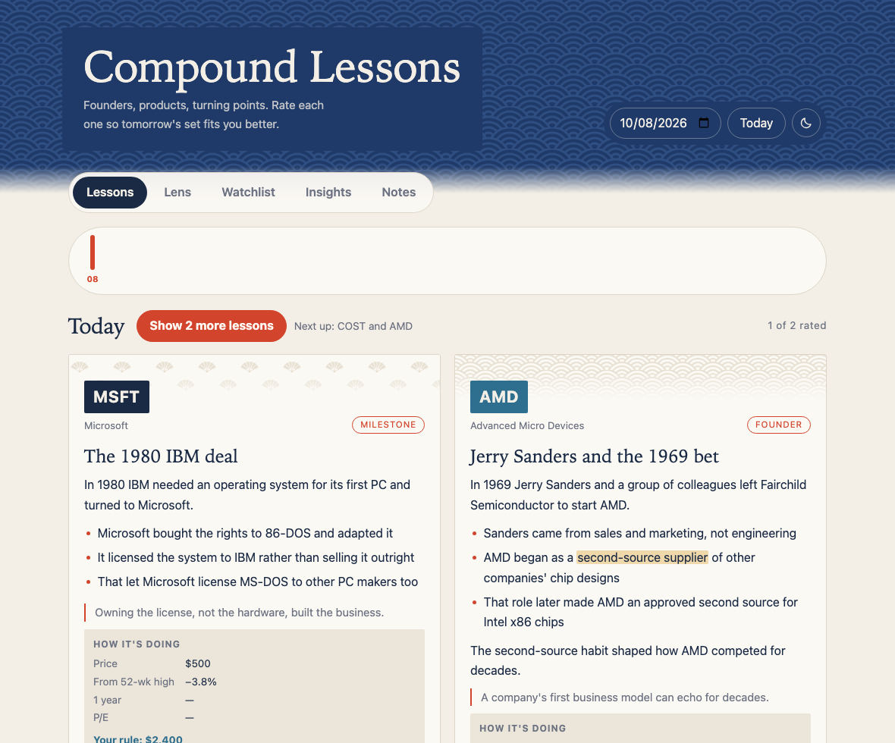
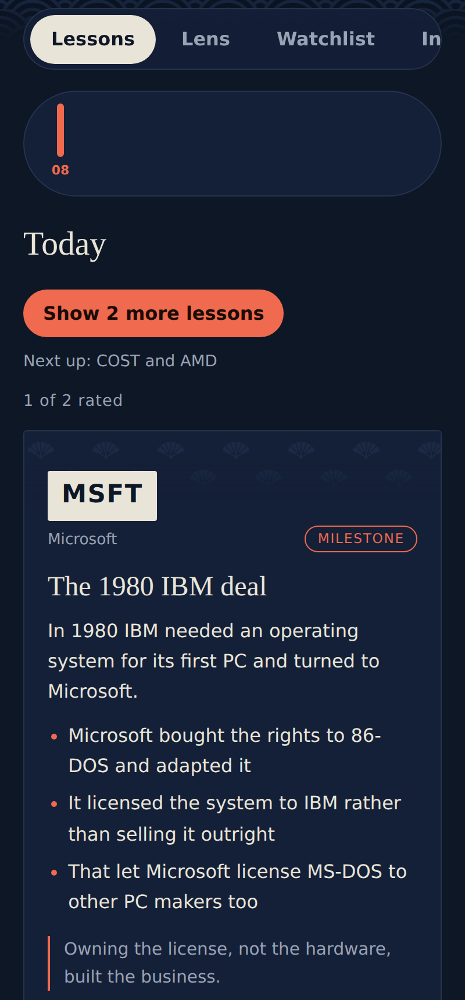

# Compound Lessons

A small daily habit for long-term investors: every day you get short, specific lessons about companies on your watchlist (founders, origin stories, products, management, milestones) and rate each one 1–5. The app learns from your ratings, so tomorrow's lessons lean toward what you find useful.

It runs as a single HTML page inside [Claude](https://claude.ai) as a published artifact. Claude writes the lessons. The page stores your history, ratings and notes privately per user.



> Not financial advice. Lessons are educational, the buy rule is arithmetic on settings you choose, and prices come from a snapshot that can be out of date.

## Features

- **Lessons:** two lessons a day from your watchlist, with "Show 2 more" for as many as you like. Newest appear first, and each one is rated 1–5.
- **Lens:** the watchlist through the questions Buffett and Munger are known for asking: circle of competence, moat, management, margin of safety, inversion and the 10-year test. It's written in Claude's own words, with no invented quotes and no buy or sell calls. Star the sections you want more of.
- **Personalization:** lessons lean toward the categories and companies you rate highly, while about one in three still explores something new.
- **Watchlist and buy rule:** a table of price, 52-week range, distance from the high, next earnings and the amount your own rule suggests. The rule buys a minimum near the high and scales up as a stock falls, splitting the buy around earnings. Prices refresh by asking Claude, which looks them up in chat and writes a snapshot, or you can enter them yourself.
- **Highlights and notes:** select any text to highlight it in one of three colors or attach a note. Whole-card notes work too.
- **Follow-ups:** ask Claude about a highlighted passage or a whole card. Answers are capped at about 80 words, so you go deeper only when you choose to.
- **Notes tab:** every highlight, note and follow-up, newest first. You can search and filter it, jump back to the card, and export everything as Markdown or HTML, with each item linked to its lesson.
- **Insights:** a 30-day rating trend, ratings by category and company, your favourite lessons, and the categories you've explored least.
- **Design:** seigaiha waves, ōgi fans and uroko triangles in indigo and vermilion, with light and dark mode.



## Run it

The page relies on Claude's artifact runtime (`window.claude`) for generation, storage and downloads, so it runs inside Claude and you need a Claude account.

### Open a shared link

If someone shares their published link with you, open it while signed in to Claude. You get your own private history, ratings, notes and price snapshot. Only the person who published the page can use **Ask Claude to refresh prices**, so type prices into **Enter a price yourself** in the Watchlist tab.

### Publish your own copy

1. Download [`app/index.html`](app/index.html): open it on GitHub and press the download button.
2. In a Claude chat, attach the file and send: "Publish this as an artifact with the db, user, sample, comments and downloads capabilities."
3. Open the published link, add your tickers in the **Watchlist** tab, and press **Get today's lessons**.
4. To fill in prices, press **Ask Claude to refresh prices** in the Watchlist tab with the chat open. You can also type prices into **Enter a price yourself**.

Opened as a plain file outside Claude, the page loads but can't generate or save anything. A small local adapter for `window.claude` (storage plus an LLM API call) would be a welcome contribution.

## Project layout

```
app/index.html            the whole app: markup, styles, logic and prompts
docs/ARCHITECTURE.md      runtime, data model, prompt design and guardrails
docs/PROMPTS.md           the prompts, generated from app/index.html
scripts/extract_prompts.py  regenerates docs/PROMPTS.md
CHANGELOG.md              how the app grew
```

After editing a prompt in `app/index.html`, run `python3 scripts/extract_prompts.py` so `docs/PROMPTS.md` stays in sync.

## License

MIT. See [LICENSE](LICENSE).
